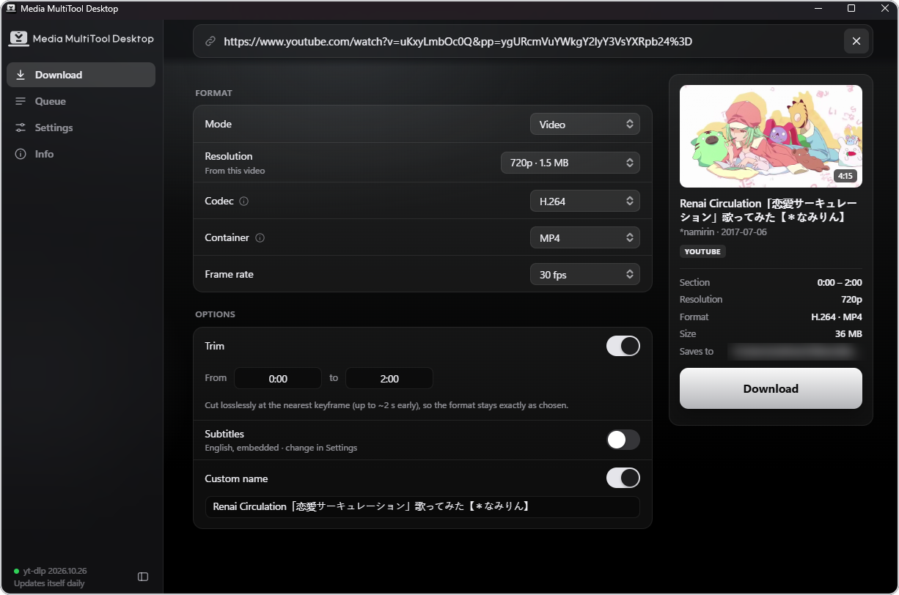
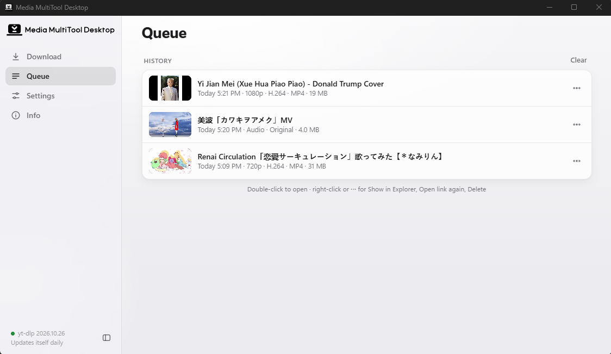
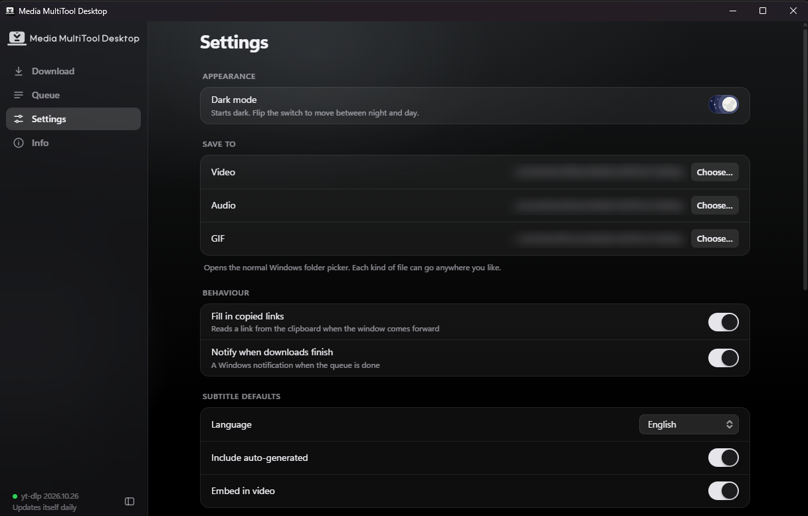

<p align="center">
  <picture>
    <source media="(prefers-color-scheme: dark)" srcset="logo/final/mmd-horizontal-white.svg">
    
  </picture>
</p>

# Media MultiTool Desktop

A Windows desktop app for saving videos, audio and GIFs from [thousands of sites](https://github.com/yt-dlp/yt-dlp/blob/master/supportedsites.md), built on [yt-dlp](https://github.com/yt-dlp/yt-dlp). Dark by default, with a light theme.

## Screenshots

<p align="center">
  <br>
  <sub>Pick the exact format, trim, add subtitles or a custom name, and see what you'll get before you download.</sub>
</p>

<p align="center">
  <br>
  <sub>The queue and history: several downloads at once, with Show in Explorer, Open link again and Delete.</sub>
</p>

<p align="center">
  <br>
  <sub>Settings, with the day and night switch.</sub>
</p>

## What it does

- **Video, Audio or GIF** from a link, with the real choices that link offers: resolution (with file size), codec, container, frame rate, audio format and bitrate, GIF width, frame rate and loop.
- **Trim** a video or audio clip, **subtitles**, a **custom name**.
- **Playlists** two ways: *Batch* (one queue entry, items in order) or *Separate* (every video is its own download). Pick a range, and an own folder with its own name. A playlist item that fails is skipped, retried automatically, and reported at the end without failing the whole job. Failed items can be retried later.
- **Several links at once**: paste a list, one per line, and download them together.
- **A queue that runs several downloads at the same time** (1 to 6), with history, Show in Explorer, Open link again and Delete (to the Recycle Bin).
- **Settings**: save folders, subtitle defaults, speed limit, retries, proxy, IPv4, Stable or Nightly yt-dlp, and the day/night switch.
- **Info**: tool versions, *Update now*, and a searchable list of every supported site.
- **New versions**: when a release with new features is published on GitHub, a small card says so, with a button to the release page. Small fixes do not trigger it. Switch it off in Settings ("Check for new versions").

## Run it from source

You need Windows 10 or 11 (with the WebView2 runtime, already part of Windows 11) and Python 3.11 or newer.

```bat
run.bat
```

The first run makes a private Python environment in `.venv`. Use `run.bat debug` to see a console with any errors.

## Build the app (.exe)

You need the same as above. Then:

```bat
build.bat
```

That is the whole build; it takes under a minute. It installs the build tools into `.venv`, runs [PyInstaller](https://pyinstaller.org), and leaves the app in `dist\`:

`dist\Media MultiTool Desktop\Media MultiTool Desktop.exe`

The whole `Media MultiTool Desktop` folder is the app (about 23 MB). Keep the exe inside it: the files next to it are part of the app.

To use it, double-click the exe. **Do not copy the exe out of its folder on its own: it needs the files beside it and will not start without them.** To move the app, or to run it on another PC, copy the whole `Media MultiTool Desktop` folder (zip it first if you like; make a shortcut to the exe if you want one on the desktop). There is no installer. Besides the app's data folder (below), the only thing it writes is one small per-user Windows entry that gives its notifications the app's name and icon. Add `nopause` (`build.bat nopause`) to close the window when it finishes.

The exe is **not** committed to the repository; `dist\` and `build\` are ignored by Git. To publish a build, zip the folder yourself and attach it to a GitHub release.

## First run: the tools it needs

yt-dlp does the downloading, ffmpeg joins and converts, and Deno lets yt-dlp read YouTube. They are not bundled, so the build stays small and always gets the current yt-dlp. On first start the app asks once to download whatever is missing (up to about 190 MB) from their official GitHub releases into its own folder:

- `%LOCALAPPDATA%\MediaDesktop` for the built exe,
- `%USERPROFILE%\.media-desktop` when run from source with the Microsoft Store version of Python (that version redirects `AppData`, which stops downloaded programs from starting),
- or the folder in the `MEDIA_DESKTOP_HOME` environment variable.

Nothing is installed system-wide. If ffmpeg or Deno are already on your `PATH`, those are used. yt-dlp is always the app's own copy, because that is the one that can update itself (about once a day, Stable or Nightly in Settings). It is always run with `--ignore-config`, so a config file of your own can't change what the app asks for.

Settings, history and the tools live in that same folder.

## Develop

```bat
.venv\Scripts\python -m unittest discover -s tests
node --test tests/model.test.js
.venv\Scripts\python src\app.py --dev 5190
```

The last command serves the UI and the same API over `http://127.0.0.1:5190/` (this machine only), so the interface can be tested in a normal browser against the real backend. `--dev` also lets the app use a yt-dlp from your `PATH` (set `MEDIA_DESKTOP_USE_PATH_YTDLP=1` to allow that in the normal app).

| Path | What it is |
|---|---|
| `src/app.py` | The window, the API the page calls, the dev server |
| `src/model.py` | Choices to yt-dlp arguments, progress parsing, playlist bookkeeping (pure, tested) |
| `src/engine.py` | Finds and downloads the tools, reads a link, runs one download |
| `src/jobs.py` | The queue: concurrency, playlist retries, history |
| `src/prefs.py`, `src/winutil.py` | Saved settings; clipboard, Recycle Bin, Explorer, notifications |
| `ui/` | The interface. `model.js` holds the format and size logic (tested). `ui/img` holds the few logo files the app uses |
| `tests/` | Python and JavaScript tests |
| `design/mockup.html` | The approved design. `tools/make_index.py` builds `ui/index.html` from it |
| `logo/` | The full logo kit (see its README). `python tools/sync_logo.py` copies the files the app uses into `ui/img` |
| `run.bat`, `build.bat` | Run from source; build the exe |

## Releasing a new version

1. Raise `APP_VERSION` in `src/app.py`.
2. Run `build.bat`, then zip the `dist\Media MultiTool Desktop` folder.
3. On GitHub, make a new release whose tag matches (for example `v1.1.0`) and attach the zip.

Which number you raise decides whether people are told:

| Change | Version | The "new version" card |
|---|---|---|
| Small fix, build or README change | last number: `1.0.0` to `1.0.1` | not shown (the release is still on GitHub) |
| New feature | middle number: `1.0.1` to `1.1.0` | shown |
| Big change | first number: `1.1.0` to `2.0.0` | shown |

Plain commits never trigger anything; only a published release does. The app asks GitHub for the latest release once per start, sends nothing else, and ignores drafts and pre-releases.

## Notes

- Downloading from some sites, YouTube included, may be against their terms of service. Use this for content you are allowed to save, for your own use.
- Media MultiTool Desktop does not include or modify yt-dlp, ffmpeg or Deno; it downloads and runs them. They have their own licences.
- Notifications come from "Media MultiTool Desktop" with the app icon. Clicking one opens the finished file, or its folder when there are several.
- MIT licence, see `LICENSE`.
